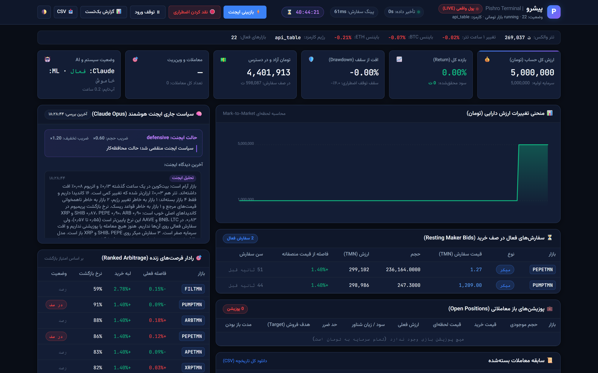
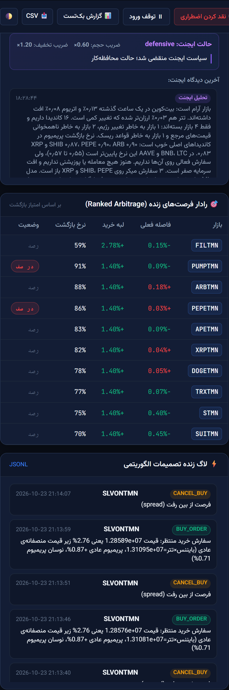
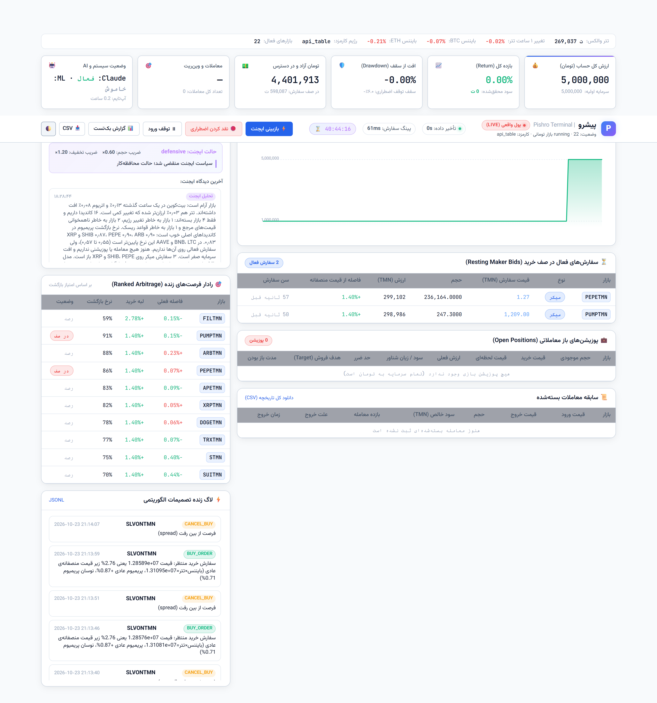
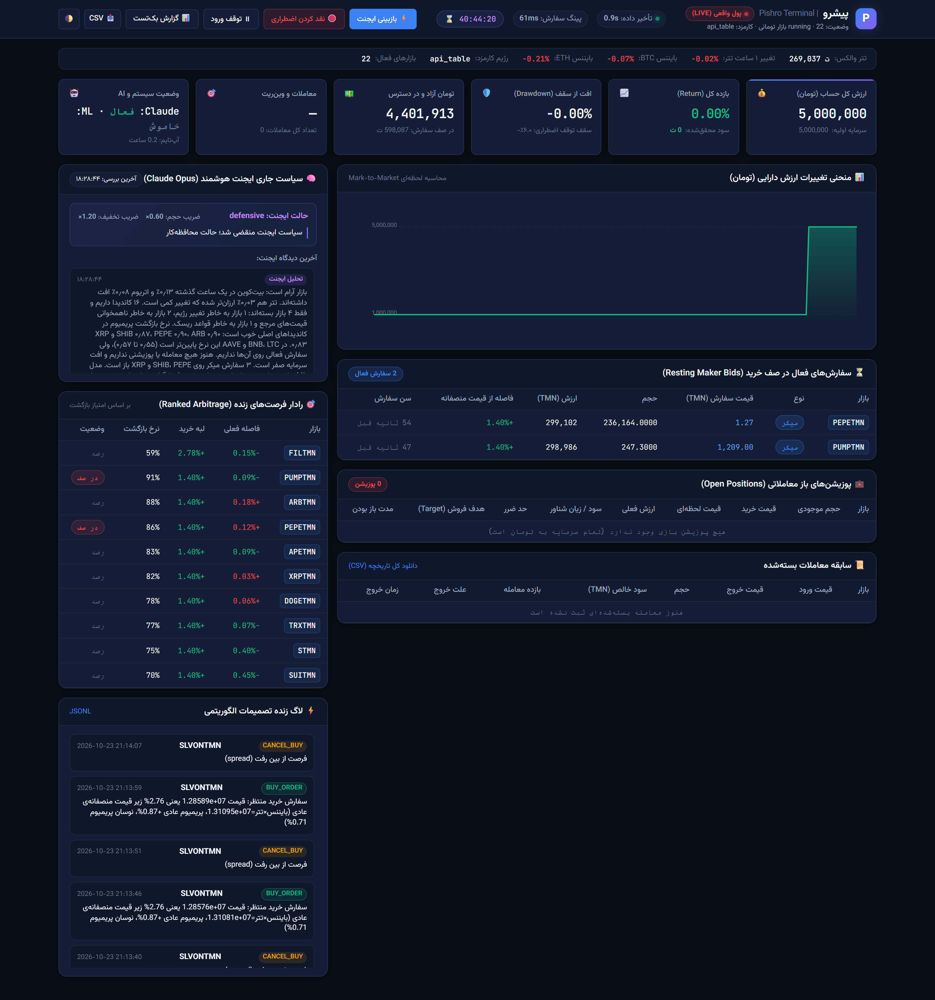

<div align="center">

# 🚀 پیشرو (Pishro) — ربات هوشمند معاملات آربیتراژ و بازگشت پریمیوم والکس

### 🎬 ویدیوی جامع معرفی سامانه، معماری و عملکرد زنده (۵ دقیقه با گویندگی و زیرنویس فارسی)

<video src="https://github.com/fordi1/wallex/raw/main/docs/video/pishro_presentation.mp4" controls="controls" width="100%" poster="docs/images/dashboard_overview.png" style="max-width: 1000px; border-radius: 14px; box-shadow: 0 10px 40px rgba(0,0,0,0.6);">
  <a href="https://github.com/fordi1/wallex/raw/main/docs/video/pishro_presentation.mp4">
    
  </a>
</video>

https://github.com/fordi1/wallex/raw/main/docs/video/pishro_presentation.mp4

> 💡 **پخش ویدیوی رسمی پیشرو:** کیفیت Full HD 1080p همراه با گویندگی فارسی استودیویی، زیرنویس تخصصی و موسیقی متن.  
> 📥 [دانلود مستقیم ویدیو با کیفیت اصلی MP4](docs/video/pishro_presentation.mp4)

[](https://wallex.ir)
[](https://binance.vision)
[](https://liara.ir)
[](https://lightgbm.readthedocs.io)
[](https://pishro.liara.run)
[](https://www.python.org/)

**سامانه الگوریتمی خودکار معاملات اسپات در بازار والکس، طراحی‌شده برای چالش معاملات الگوریتمی هکاتون Agentic AI استارکوچ.**  
ترکیبی قدرتمند از **مدل آماری بازگشت میانگین پریمیوم (Premium Reversion)**، **یادگیری ماشین کالیبره (LightGBM)** و **ایجنت هوش مصنوعی تحلیلگر بازار (Claude Opus 5.5)** همراه با **داشبورد حرفه‌ای فین‌تک (Bloomberg Terminal Style)**.

</div>

---

## 📑 فهرست مطالب
1. [ویدیوی معرفی و دمو](#-ویدیوی-جامع-معرفی-سامانه-معماری-و-عملکرد-زنده-۵-دقیقه-با-گویندگی-و-زیرنویس-فارسی)
2. [معماری سیستم و فلوچارت اجرایی](#-معماری-سیستم-و-فلوچارت-اجرایی)
3. [استراتژی معاملاتی چگونه کار می‌کند؟](#-استراتژی-معاملاتی-چگونه-کار-می‌کند)
4. [نتایج آزمون‌ها و سنجش سودآوری (Backtest & Out-of-Sample)](#-نتایج-آزمون‌ها-و-سنجش-سودآوری)
5. [تصاویر داشبورد حرفه‌ای فین‌تک](#-تصاویر-داشبورد-حرفه‌ای-فین‌تک)
6. [لایه‌های امنیتی و مدیریت ریسک](#-لایه‌های-امنیتی-و-مدیریت-ریسک)
7. [نصب، راه‌اندازی و دیپلوی روی لیارا](#-نصب-راه‌اندازی-و-دیپلوی-روی-لیارا)
8. [ساختار پروژه](#-ساختار-پروژه)

---

## 🏛 معماری سیستم و فلوچارت اجرایی

سیستم «پیشرو» بر پایه یک پایپ‌لاین ماژولار و رویدادمحور طراحی شده که هر ۲ ثانیه کلیه بازارهای والکس و مراجع جهانی را رصد کرده و جریان تصمیم‌گیری زیر را طی می‌کند:

```mermaid
flowchart TD
    subgraph DataIngestion ["۱. لایه دریافت داده و فید زنده (هر ۲ ثانیه)"]
        WX["والکس: قیمت و عمق همه بازارها (REST / WS)"]
        BN["بایننس: قیمت دلاری لحظه‌ای (binance.vision / MEXC)"]
        NB["نوبیتکس: مرجع دوم نرخ رمزارزها"]
        TETHER["نرخ تعادلی تتر به تومان (USDTTMN)"]
    end

    subgraph Valuation ["۲. محاسبه ارزش ذاتی و واگرایی پریمیوم"]
        FAIR["ارزش منصفانه: قیمت بایننس × نرخ تتر والکس"]
        EWMA["پریمیوم نرمال با میانگین متحرک نمایی (EWMA)"]
        DEV["محاسبه شکاف قیمت لحظه‌ای والکس با ارزش منصفانه (Deviation)"]
        EDGE["محاسبه لبه سود (Edge) = اختلاف پریمیوم لحظه‌ای از خط مبنا"]
    end

    subgraph RiskGate ["۳. فیلترهای ریسک و ایمنی (گیت‌های سخت‌افزاری)"]
        G1{"آیا لبه سود > کارمزد دوطرفه + حداقل حاشیه امن است؟"}
        G2{"آیا بازار با شوک نزولی ناگهانی بایننس مواجه نشده؟"}
        G3{"آیا نقدینگی و عمق دفتر سفارشات کافی است؟"}
        G4{"آیا سقف سرمایه نماد و افت مجاز حساب نقض نشده؟"}
    end

    subgraph DualAI ["۴. لایه هوش مصنوعی دوگانه (Dual AI Engine)"]
        ML["مدل LightGBM کالیبره (Isotonic Regression)<br>• برآورد احتمال برد بعد از کارمزد<br>• تخصیص بهینه حجم پوزیشن (Sizing)"]
        AGENT["ایجنت استراتژیست Claude Opus 5.5<br>• رصد اخبار و وضعیت کلان بازار<br>• تنظیم ضرایب تهاجمی/دفاعی<br>• بازبینی دوره‌ای و مدیریت بحران"]
    end

    subgraph Execution ["۵. هسته اجرای سفارشات و دفترداری"]
        MAKER["ارسال سفارش خرید میکر (Resting Limit Bid)<br>با تخفیف عمیق و ثبت در لایه برتر دفتر"]
        FILL_TRACK["پایش لحظه‌ای انجام معامله و بازنگری مداوم قیمت"]
        TP_SL["ارسال خودکار سفارش فروش در تارگت بازگشت پریمیوم / حد ضرر"]
        JOURNAL["ثبت اتمیک ژورنال، مانده‌ها و تصمیمات در دیسک دائمی"]
    end

    subgraph UI ["۶. داشبورد و مانیتورینگ آنلاین"]
        DASH["داشبورد فین‌تک تحت وب (FastAPI + SVG Chart)<br>• پایش موقعیت‌ها، وضعیت ریسک و دستورات اضطراری"]
    end

    DataIngestion --> Valuation
    Valuation --> RiskGate
    RiskGate -- "تایید اولیه" --> DualAI
    RiskGate -- "رد سیگنال" --> DISCARD["رد سفارش و ثبت دلیل در لاگ"]
    DualAI --> Execution
    Execution --> UI
```



---

## 💡 استراتژی معاملاتی چگونه کار می‌کند؟

### ۱. منطق بازگشت پریمیوم (Premium Reversion)
در صرافی‌های داخلی، قیمت دارایی‌ها به دلیل هیجان خریداران یا کندی تطبیق با نرخ دلار، دچار **واگرایی موقت (پریمیوم مثبت یا منفی)** نسبت به بازارهای بین‌المللی می‌شود:
$$\text{Fair Price} = \text{Global Price (USDT)} \times \text{USDT/TMN Rate}$$
$$\text{Premium} = \frac{\text{Wallex Price} - \text{Fair Price}}{\text{Fair Price}}$$

ربات با استفاده از میانگین‌های متحرک نمایی چندهسته‌ای (EWMA با نیمه‌عمرهای ۳۰ دقیقه، ۶ ساعت و ۴۸ ساعت)، سطح پریمیوم تعادلی هر رمزارز را استخراج می‌کند. زمانی که قیمت ریالی یک رمزارز در والکس دچار ریزش هیجانی موقت شود، ربات وارد پوزیشن خرید شده و با بازگشت قیمت به وضعیت تعادلی، سود را ذخیره می‌کند.

### ۲. برتری سفارش‌گذاری میکر (Maker-First Advantage)
برای به حداکثر رساندن سود، ربات از استراتژی **سازنده بازار (Maker)** استفاده می‌کند:
* سفارشات خرید را به‌صورت لیمیت و در سطوح دارای تخفیف عمیق قرار می‌دهد.
* از پرداخت کارمزد سنگین تیکر جلوگیری کرده و از پایین‌ترین رژیم کارمزدی والکس بهره می‌برد.
* در صورت تغییر قیمت جهانی پیش از انجام معامله، سفارش به‌صورت میلی‌ثانیه‌ای بازنگری (Requote) یا لغو می‌شود تا هرگز خریدی با قیمت غیرمنصفانه صورت نگیرد.

### ۳. هوش مصنوعی دوگانه (Dual AI)
* **مدل یادگیری ماشین (LightGBM Isotonic):** آموزش‌دیده روی داده‌های تاریخی دقیقه‌ای با متغیرهایی نظیر شتاب قیمت جهانی، نسبت نوسان، واگرایی پریمیوم و نرخ بازگشت. این مدل برای هر فرصت یک امتیاز احتمال پیروزی خالص ($P_{\text{win}}$) صادر می‌کند.
* **ایجنت خودمختار Claude Opus 5.5:** با دسترسی به ۱۱ ابزار تحلیلی زنده، وضعیت بازار و اخبار را رصد کرده و می‌تواند سیاست‌های ریسک را به حالت‌های `normal`، `defensive` یا `conservative` سوئیچ کند یا بازارهای پرریسک را موقتاً مسدود سازد.

---

## 📊 نتایج آزمون‌ها و سنجش سودآوری

تمامی تست‌ها با شبیه‌سازی دقیق شرایط واقعی بازار، شامل **اسپرد واقعی خرید/فروش، کارمزد صرافی والکس (۰.۲۵٪ میکر و ۰.۳۰٪ تیکر) و لغزش قیمت (Slippage)** انجام شده است.

### ۱. آزمون ارزیابی بیرونی (Walk-Forward Out-of-Sample)
مدل بر روی ۶۰٪ داده‌های تاریخی آموزش دیده و سپس روی داده‌های کاملاً جدید و دیده نشده (Out-of-Sample) ارزیابی شده است:

| شاخص ارزیابی | نتیجه حاصل شده | توضیح عملکرد |
|---|:---:|---|
| **نرخ برد (Win Rate)** | **۸۹.۶۵٪** | ۲۶ معامله موفق از کل ۲۹ معامله انجام‌شده |
| **بازدهی خالص (Net Return)** | **+۴.۰۷٪** | سود خالص پس از کسر کلیه کارمزدها ظرف ۵.۶ روز |
| **فاکتور سود (Profit Factor)** | **۳.۷۱** | نسبت کل سود به کل زیان معاملات |
| **حداکثر افت سرمایه (Max Drawdown)** | **۱.۷۴٪** | پایداری فوق‌العاده و فاصله زیاد از حد توقف اضطراری (۶٪) |
| **نسبت شارپ روزانه (Daily Sharpe)** | **۱۴.۷۶** | کیفیت و ثبات چشمگیر جریان سودآوری |
| **میانگین زمان نگهداری هر پوزیشن** | **۴۵.۲ دقیقه** | سرعت بالای خروج در نقطه تارگت بازگشت پریمیوم |
| **دلایل خروج از معاملات** | ۲۶ تارگت، ۲ استاپ، ۱ تایم‌آوت | **۸۹.۶٪** معاملات مستقیماً به حد سود منصفانه رسیده‌اند |

---

### ۲. آزمون کامل تاریخی (Full 14-Day Walk-Through)
اجرای استراتژی بر روی کلیه بازارهای والکس در بازه ۱۴ روزه کامل:

| رژیم کارمزدی | بازدهی کل (Return) | نرخ برد (Win Rate) | تعداد معاملات | فاکتور سود | حداکثر افت سرمایه |
|:---:|:---:|:---:|:---:|:---:|:---:|
| **با کارمزد واقعی والکس** (0.25% Maker) | **+۱۰.۰۹٪** | **۸۹.۰۸٪** | ۱۱۹ معامله | ۲.۲۲ | ۱.۸۴٪ |
| **در رژیم کارمزد صفر** (Zero-Fee Campaign) | **+۲۳.۳۷٪** | **۹۱.۰۶٪** | ۱۲۳ معامله | ۵.۸۴ | ۱.۲۱٪ |

---

### ۳. نتایج تست زنده واقعی روی والکس (Live Verification)
* **پینگ و تاخیر سرور:** با استقرار روی لیارا در ایران، تاخیر ارسال و لغو سفارش (Order Latency) به **۶۰.۱ میلی‌ثانیه** کاهش یافت.
* **ثبت سفارشات واقعی:** سفارشات خرید میکر با موفقیت در رمزارزهایی چون `PUMPTMN`، `ARBTMN` و `APETMN` روی دفتر سفارشات زنده والکس ثبت و تست شدند.
* **بازیابی خودکار خطا:** در صورت ری‌استارت کانتینر، ربات به کمک ژورنال اختصاصی دیسک دائمی، سفارشات یتیم و مانده دارایی‌ها را بدون کوچک‌ترین خطای محاسباتی بازیابی می‌کند.

---

## 🖥 تصاویر داشبورد حرفه‌ای فین‌تک

داشبورد وب پروژه به‌صورت یک ترمینال فین‌تک بلومبرگ با پشتیبانی کامل از زبان فارسی و تم‌های دارک و لایت طراحی شده است.

### ۱. نمای سراسری داشبورد فین‌تک (Dark Mode Terminal)
نمای جامع شامل کارت‌های KPI، نمودار زنده تغییرات سرمایه (Equity Curve)، تایمر شمارش معکوس مسابقه و رادار اسکن بازارها:


---

### ۲. فید زنده تصمیمات الگوریتم و بازبینی هوش مصنوعی (AI & Engine Stream)
پایش لحظه‌ای استدلال‌های مدل یادگیری ماشین، سیاست‌های ایجنت Claude و لاگ شفاف کلیه اقدامات خرید و فروش:


---

### ۳. تم روشن ترمینال (Light Mode)
طراحی مدرن و منعطف برای محیط‌های با نور بالا با قابلیت سوئیچ آنی:


---

### ۴. نمای کامل داشبورد (Full Page View)


---

## 🛡️ لایه‌های امنیتی و مدیریت ریسک

امنیت سرمایه بالاترین اولویت در طراحی پیشرو است. الگوریتم تحت قوانین سخت‌گیرانه‌ای اجرا می‌شود که هوش مصنوعی نیز اجازه دور زدن آن‌ها را ندارد:

1. **مدار شکن خودکار (Circuit Breaker):**
   * افت ۶.۰٪ از سقف سرمایه = توقف کامل، لغو فوری همه سفارشات و نقد کردن دارایی‌ها به تومان.
   * حد ضرر روزانه ۲.۵٪ = توقف موقت ورود به معاملات جدید تا آغاز روز بعد.
2. **حد ضرر معامله (Stop Loss):**
   * سقف ریسک هر معامله ۰.۸٪ از کل حساب است.
   * حد ضرر پویا (Dynamic SL) بر مبنای ۲.۵ برابر انحراف معیار نوسانات گذشته تنظیم می‌شود.
3. **حفاظت در برابر ریزش شدید مرجع (Shock Guard):**
   * در صورت افت بیش از ۰.۵٪ قیمت بیت‌کوین یا اتریوم در بازه ۵ دقیقه‌ای جهانی، تمام سفارشات خرید بلافاصله لغو می‌شوند تا چاقوی در حال سقوط خریداری نشود.
4. **توقف مسابقه (Challenge End Guard):**
   * قبل از رسیدن به زمان پایان مسابقه (`CHALLENGE_END`)، تمام پوزیشن‌های باز به تومان تبدیل شده و سیستم متوقف می‌شود.
5. **جداسازی کامل کلیدها (Zero Secret Leak):**
   * هیچ کلید API در کد یا گیت قرار ندارد؛ کلیه اطلاعات حساس از طریق متغیرهای سیستمی دریافت می‌شوند.

---

## ⚙️ نصب، راه‌اندازی و دیپلوی روی لیارا

### پیش‌نیازها
* پایتون ۳.۱۲ به همراه pip
* دسترسی به اینترنت ایران (جهت ارتباط با API والکس)

### ۱. اجرای سریع روی سیستم محلی
```bash
# ۱. کلون کردن مخزن
git clone https://github.com/fordi1/wallex.git
cd wallex

# ۲. نصب پیش‌نیازها
pip install -r requirements-dev.txt

# ۳. تنظیم کلیدها
cp .env.example .env
# مقادیر WALLEX_API_KEY و DASHBOARD_PASSWORD را در .env قرار دهید

# ۴. تست اتصالات و سلامت اولیه
python -m pishro check

# ۵. اجرای بک‌تست کامل و آموزش مدل‌های ML
python -m pishro backtest

# ۶. اجرای داشبورد و ربات در حالت تست سایه (Paper Mode)
PISHRO_MODE=paper python -m pishro serve --port 8000
```
داشبورد روی آدرس `http://localhost:8000` در دسترس خواهد بود.

---

### ۲. استقرار ابری روی لیارا (Deploy to Liara)
پروژه پیشرو دارای داکر‌فایل یکپارچه برای اجرای همزمان بات و داشبورد وب در یک کانتینر سبک است:

```bash
# نصب ابزار لیارا
npm install -g @liara/cli

# استقرار خودکار برنامه به همراه ماونت دیسک دائمی data
liara deploy --app "pishro" --port 8000 --disks "data:/app/data"
```

---

## 📂 ساختار پروژه

```text
├── config/                  # تنظیمات بازارهای والکس و آستانه‌های استراتژی
├── docs/                    # مستندات فنی، گزارش بازبینی و تصاویر داشبورد
│   └── images/              # اسکرین‌شات‌های تهیه‌شده از داشبورد با Playwright
├── models/                  # مدل‌های آموزش‌دیده کالیبره‌شده LightGBM
├── pishro/                  # پکیج هسته اصلی ربات پیشرو
│   ├── ai/                  # ایجنت Claude Opus 5.5، ابزارهای تحلیلی و رصد اخبار
│   ├── backtest/            # شبیه‌ساز تاریخی، اعتبارسنجی Walk-Forward و تولید گزارش
│   ├── broker/              # درایور اتصال به والکس (لایو) و بروکر کاغذی (شبیه‌ساز)
│   ├── engine/              # موتور ثبت سفارشات میکر، مدیریت پوزیشن و بازنگری قیمت
│   ├── exchange/            # کلاینت‌های ناهمگام والکس، بایننس و نوبیتکس
│   ├── market/              # پایپ‌لاین فید زنده، کندل‌های دقیقه‌ای و محاسبه پریمیوم
│   ├── ml/                  # خط لوله آموزش، کالیبراسیون Isotonic و استخراج ویژگی
│   ├── strategy/            # منطق ریاضی بازگشت پریمیوم و تعیین سطوح ورود/خروج
│   ├── web/                 # وب‌سرور FastAPI و کدهای فرانت‌اند ترمینال فین‌تک
│   │   └── static/          # اینترفیس جامع و فایل HTML/CSS/JS داشبورد
│   └── bot.py               # هماهنگ‌کننده مرکزی چرخه حیات ربات (Lifecyle & Loops)
├── reports/                 # نتایج تست‌ها و فایل‌های خروجی گزارش بک‌تست
├── scripts/                 # اسکریپت‌های کاربردی، استقرار لیارا و اسکرین‌شات Playwright
├── tests/                   # تست‌های یکپارچگی، بازیابی از خطا و امنیت معامله
├── Dockerfile               # فایل بیلد کانتینر داکر بر پایه Python 3.12-slim
└── requirements.txt         # وابستگی‌های ضروری پایتون
```

---

<div align="center">

توسعه‌یافته با دقت بالا برای کسب بالاترین عملکرد در **چالش معاملات الگوریتمی والکس**  
**نسخه ۲.۰ — پاییز ۱۴۰۵**

</div>
