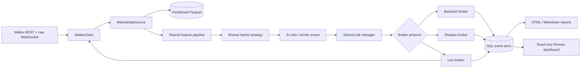

# Architecture

The exchange boundary is deliberately narrow: only
`src/wallex_engine/exchange/wallex_client.py` contains Wallex transport details.
Backtest, shadow, and live modes use the same feature, signal, AI-review, risk,
decision, and persistence models. Their broker/data adapters are replaceable
through protocols in `src/wallex_engine/protocols.py`.

The live process is single-leader. PostgreSQL owns a session advisory lock for
the lifetime of the engine, preventing a second replica from submitting orders.
Every order intent is durable before submission and uses a deterministic client
ID. An ambiguous submission is looked up by that ID before any retry.

